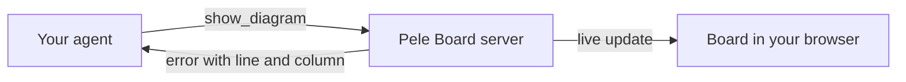

<p align="center">
  
</p>

<p align="center">
  <strong>See what your coding agent is thinking.</strong><br>
  It draws plans, processes and architecture as diagrams on a live page in your browser,<br>
  and updates them as the work moves on.
</p>

<p align="center">
  <a href="#claude-code"></a> <a href="#codex"></a> <a href="https://pele.run"></a>  <a href="LICENSE"></a>
</p>

<p align="center">
  <a href="#install">Install</a> · <a href="#first-use">First use</a> · <a href="#what-it-can-draw">What it can draw</a> · <a href="#how-it-works">How it works</a> · <a href="#privacy">Privacy</a>
</p>

<picture>
  <source media="(prefers-color-scheme: dark)" srcset="docs/board-dark.png">
  
</picture>

## Why

Agents explain structure in paragraphs: which service calls which, what happens after a step fails, how far a
migration has got. You rebuild the picture in your head. Pele Board lets the agent show you the picture instead.

- **Diagrams that never arrive broken.** The agent writes Mermaid; pele checks it before you see it, and any error
  goes back to the agent with its line and column so it can fix it.
- **Progress you can glance at.** For longer tasks the agent keeps one diagram up to date. Finished steps turn
  green, the current step blue, blocked steps red.
- **A page that keeps up by itself.** No reloading, no files to open. Every diagram from the session stays one
  click away in the sidebar.

<p align="center">
  
</p>

## Install

You need [Node.js](https://nodejs.org) 20 or later (check with `node --version`) and Claude Code or the Codex CLI
running on your own computer. No account or API key is needed.

### Claude Code

In Claude Code, submit:

```text
/plugin marketplace add ossianravn/pele-agent-plugin
```

Then submit:

```text
/plugin install pele-board@pele-board
```

Restart Claude Code. Run `/plugin` and check that **pele-board** is listed as enabled.

<details>
<summary>From a terminal instead</summary>

```sh
claude plugin marketplace add ossianravn/pele-agent-plugin
claude plugin install pele-board@pele-board
```

</details>

### Codex

In a terminal, run:

```sh
codex plugin marketplace add ossianravn/pele-agent-plugin
codex plugin add pele-board@pele-board
```

Start a new Codex session. Run `codex mcp list` and check that **pele-board** is listed as enabled.

## First use

Ask for a picture of something in your project:

```text
Show me a diagram of how a request moves through this app.
```

The board opens in your browser with the diagram. For longer work, ask the agent to track it:

```text
Plan the migration as a diagram on the Pele Board and update it as you finish each step.
```

On the board you can:

- pick any diagram from the session in the sidebar; the view follows the newest update until you pick an older
  one, and a dot marks diagrams that changed since you looked
- zoom and pan large diagrams with the buttons, a pinch, or Ctrl/⌘ and the scroll wheel
- copy a diagram's Mermaid source, or download it as an SVG in the current light or dark colors

The board belongs to one agent session. When the session ends, the open page keeps showing the last diagrams and
says it is offline.

## What it can draw

| Kind | Diagrams |
| --- | --- |
| Flow and process | flowchart, sequence, state, swimlane, user journey, agentflow |
| Structure | architecture, class, entity relationship, block, C4, tree view, requirement |
| Time and work | Gantt, timeline, kanban, git graph, event modeling |
| Ideas and analysis | mind map, Ishikawa, Cynefin, Wardley map, Venn, quadrant |
| Numbers | pie, XY, sankey, treemap, radar, packet |

See [pele's examples](https://pele.run/examples) for each one.

## How it works



The plugin adds a small local server and a `visualize` skill that teaches the agent when a diagram helps and which
kind to draw. The server checks each diagram with [pele](https://pele.run), Obsidian's Mermaid renderer, and pushes
it to the open board page, which renders it at your screen's width in light or dark mode.

## Settings

Set these in your agent's environment if you need them:

| Variable | Effect |
| --- | --- |
| `PELE_BOARD_NO_OPEN=1` | Never open the browser; the agent gives you the board's address instead. |
| `PELE_BOARD_PORT` | Use this port instead of a random free one. Falls back to a free port if it is taken. |

## Privacy

Everything runs on your computer. The board listens only on `127.0.0.1`, refuses requests addressed to any other
host name, and keeps diagrams in memory for the session. Nothing is uploaded. A diagram that links to an image on
the web loads it when you view the diagram.

Cloud and remote agent sessions run the server on another machine, so the board can't reach your browser there.

## Update and remove

| | Update | Remove |
| --- | --- | --- |
| Claude Code | `claude plugin update pele-board@pele-board`, then restart | `claude plugin uninstall pele-board@pele-board` |
| Codex | `codex plugin marketplace upgrade pele-board`, then start a new session | `codex plugin remove pele-board@pele-board` |

The plugin stores no files outside its installed folder.

## Development

```sh
npm install
npm run typecheck
npm run build           # bundles src/ and web/ into plugin/dist/, which is committed
npm run check:examples  # renders every Mermaid example in the skill with the pinned pele
```

Users install only the `plugin/` folder, which holds the manifests, the skill and the bundled server; the build
tools at the repository root never reach them. `plugin/dist/` is committed because Codex runs plugins without
installing dependencies. Rebuild it after changing `src/` or `web/`, and keep the version in `package.json`,
`plugin/plugin.json`, `plugin/.claude-plugin/plugin.json` and `src/server.ts` in step. Tested hosts and versions
are in [docs/compatibility.md](docs/compatibility.md).

## License

[MIT](LICENSE). Pele Board is not affiliated with pele or Obsidian. Licenses of bundled libraries are in
[plugin/dist/THIRD_PARTY_LICENSES.txt](plugin/dist/THIRD_PARTY_LICENSES.txt).
