<p align="center">
  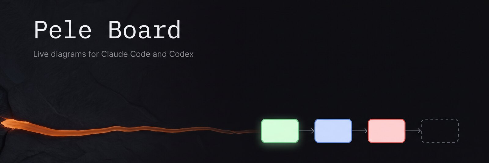
</p>

<p align="center">
  <strong>See what your coding agent is thinking.</strong><br>
  It draws plans, processes and architecture as diagrams on a live page in your browser,<br>
  and updates them as the work moves on.
</p>

<p align="center">
  <a href="#claude-code"></a> <a href="#codex"></a> <a href="https://pele.run"></a>  <a href="LICENSE"></a>
</p>

<p align="center">
  <a href="#install">Install</a> · <a href="#first-use">First use</a> · <a href="#examples">Examples</a> · <a href="#what-it-can-draw">What it can draw</a> · <a href="#how-it-works">How it works</a> · <a href="#privacy">Privacy</a>
</p>

<picture>
  <source media="(prefers-color-scheme: dark)" srcset="docs/board-dark.png">
  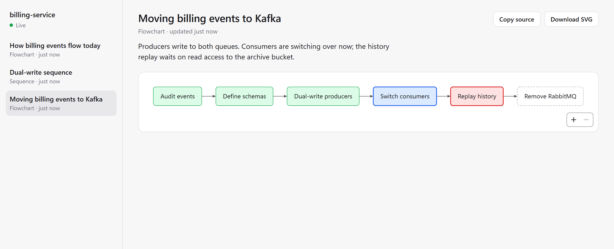
</picture>

## Why

Agents explain structure in paragraphs: which service calls which, what happens after a step fails, how far a
migration has got. You rebuild the picture in your head. Pele Board lets the agent show you the picture instead.

- **Diagrams that never arrive broken.** The agent writes Mermaid; pele checks it before you see it, and any error
  goes back to the agent with its line and column so it can fix it.
- **Progress you can glance at.** For longer tasks the agent keeps one diagram up to date. Finished steps turn
  green, the current step blue, blocked steps red.
- **A page that keeps up by itself.** No reloading, no files to open. Every diagram from the session stays one
  click away in the sidebar.

<p align="center">
  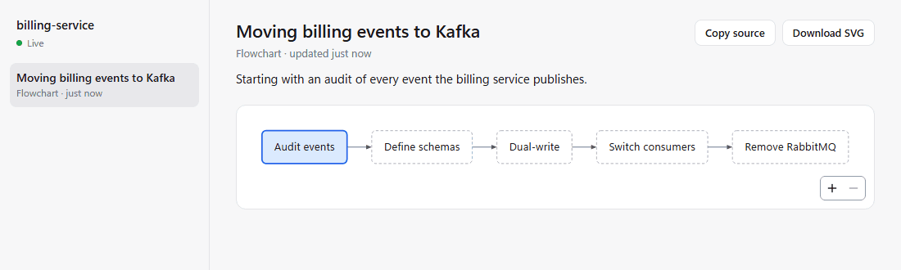
</p>

## Install

You need [Node.js](https://nodejs.org) 20 or later (check with `node --version`) and Claude Code or the Codex CLI
running on your own computer. No account or API key is needed.

### Claude Code

In Claude Code, submit:

```text
/plugin marketplace add ossianravn/pele-agent-plugin
```

Then submit:

```text
/plugin install pele-board@pele-board
```

Restart Claude Code. Run `/plugin` and check that **pele-board** is listed as enabled.

<details>
<summary>From a terminal instead</summary>

```sh
claude plugin marketplace add ossianravn/pele-agent-plugin
claude plugin install pele-board@pele-board
```

</details>

### Codex

In a terminal, run:

```sh
codex plugin marketplace add ossianravn/pele-agent-plugin
codex plugin add pele-board@pele-board
```

Start a new Codex session. Run `codex mcp list` and check that **pele-board** is listed as enabled.

## First use

Ask for a picture of something in your project:

```text
Show me a diagram of how a request moves through this app.
```

The board opens in your browser with the diagram. For longer work, ask the agent to track it:

```text
Plan the migration as a diagram on the Pele Board and update it as you finish each step.
```

On the board you can:

- pick any diagram from the session in the sidebar; the view follows the newest update until you pick an older
  one, and a dot marks diagrams that changed since you looked
- zoom and pan large diagrams with the buttons, a pinch, or Ctrl/⌘ and the scroll wheel
- copy a diagram's Mermaid source, or download it as an SVG in the current light or dark colors

The board belongs to one agent session. When the session ends, the open page keeps showing the last diagrams and
says it is offline.

## Examples

Ask in plain words; the agent picks the diagram that fits. The first example is a real Claude Code run on this
repository. The others show what the board displays for common requests.

[Get a tour of a codebase](#get-a-tour-of-a-codebase) · [Debug a race condition](#debug-a-race-condition) · [Map a data model](#map-a-data-model) · [Explain a process across people and systems](#explain-a-process-across-people-and-systems) · [Model a lifecycle](#model-a-lifecycle) · [Plan a release](#plan-a-release) · [Weigh options](#weigh-options) · [Find the root cause](#find-the-root-cause) · [Check how the agent will split up the work](#check-how-the-agent-will-split-up-the-work)

### Get a tour of a codebase

> Give me a tour of how this codebase works, as a diagram.

<picture>
  <source media="(prefers-color-scheme: dark)" srcset="docs/examples/codebase-tour-dark.png">
  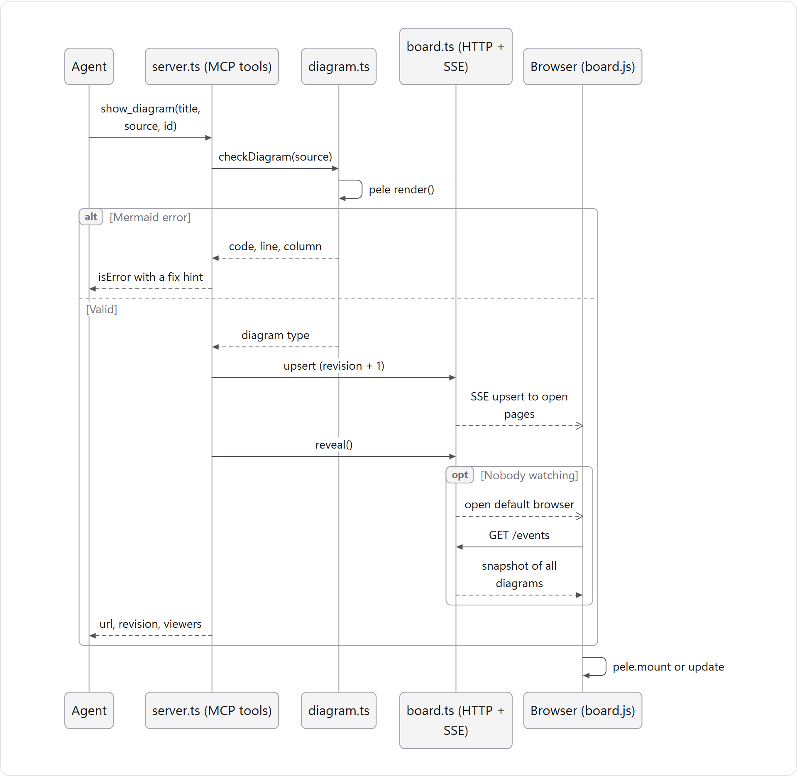
</picture>

**What happens on show_diagram.** The server renders every diagram with pele before the page sees it, so the agent gets syntax errors and the user never sees a broken diagram. Diagrams live only in memory, served on 127.0.0.1.

<sub>A real Claude Code run on this repository: it read the source and drew this, plus a second diagram of the build, in one turn.</sub>

<details>
<summary>Mermaid source</summary>

```text
sequenceDiagram
  participant A as Agent
  participant S as server.ts (MCP tools)
  participant D as diagram.ts
  participant B as board.ts (HTTP + SSE)
  participant P as Browser (board.js)
  A->>S: show_diagram(title, source, id)
  S->>D: checkDiagram(source)
  D->>D: pele render()
  alt Mermaid error
    D-->>S: code, line, column
    S-->>A: isError with a fix hint
  else Valid
    D-->>S: diagram type
    S->>B: upsert (revision + 1)
    B--)P: SSE upsert to open pages
    S->>B: reveal()
    opt Nobody watching
      B--)P: open default browser
      P->>B: GET /events
      B-->>P: snapshot of all diagrams
    end
    S-->>A: url, revision, viewers
  end
  P->>P: pele.mount or update
```

</details>

### Debug a race condition

> Some customers get charged twice when they double-click Pay. Find out why and show me.

<picture>
  <source media="(prefers-color-scheme: dark)" srcset="docs/examples/race-condition-dark.png">
  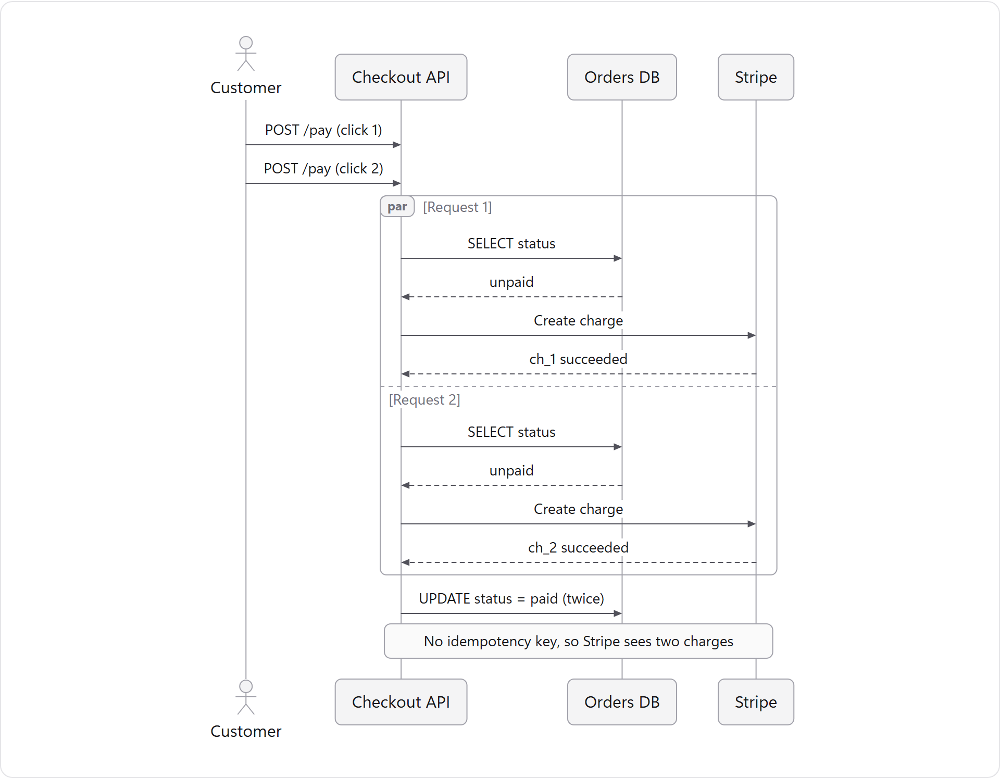
</picture>

**Why a double click charges twice.** Both requests read the order as unpaid before either marks it paid. An idempotency key on the charge, or a row lock on the order, closes the gap.

<details>
<summary>Mermaid source</summary>

```text
sequenceDiagram
  actor C as Customer
  participant API as Checkout API
  participant DB as Orders DB
  participant S as Stripe
  C->>API: POST /pay (click 1)
  C->>API: POST /pay (click 2)
  par Request 1
    API->>DB: SELECT status
    DB-->>API: unpaid
    API->>S: Create charge
    S-->>API: ch_1 succeeded
  and Request 2
    API->>DB: SELECT status
    DB-->>API: unpaid
    API->>S: Create charge
    S-->>API: ch_2 succeeded
  end
  API->>DB: UPDATE status = paid (twice)
  Note over API,S: No idempotency key, so Stripe sees two charges
```

</details>

### Map a data model

> What does our orders schema look like? Read the migrations and draw it.

<picture>
  <source media="(prefers-color-scheme: dark)" srcset="docs/examples/data-model-dark.png">
  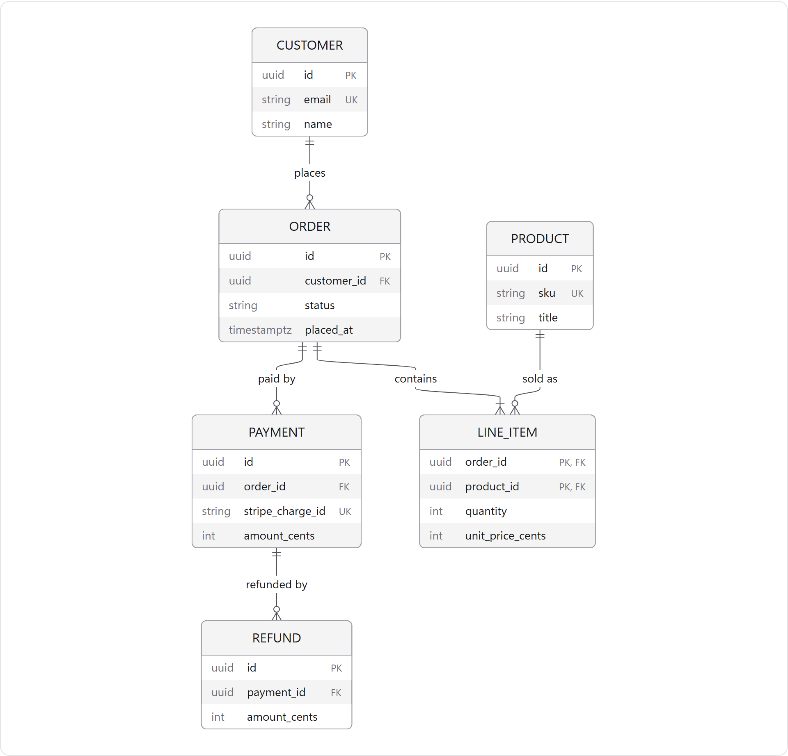
</picture>

**Orders schema.** An order belongs to one customer and has one or more line items. Refunds attach to payments, not to orders.

<details>
<summary>Mermaid source</summary>

```text
erDiagram
  CUSTOMER ||--o{ ORDER : places
  ORDER ||--|{ LINE_ITEM : contains
  PRODUCT ||--o{ LINE_ITEM : "sold as"
  ORDER ||--o{ PAYMENT : "paid by"
  PAYMENT ||--o{ REFUND : "refunded by"
  CUSTOMER {
    uuid id PK
    string email UK
    string name
  }
  ORDER {
    uuid id PK
    uuid customer_id FK
    string status
    timestamptz placed_at
  }
  LINE_ITEM {
    uuid order_id PK, FK
    uuid product_id PK, FK
    int quantity
    int unit_price_cents
  }
  PRODUCT {
    uuid id PK
    string sku UK
    string title
  }
  PAYMENT {
    uuid id PK
    uuid order_id FK
    string stripe_charge_id UK
    int amount_cents
  }
  REFUND {
    uuid id PK
    uuid payment_id FK
    int amount_cents
  }
```

</details>

### Explain a process across people and systems

> Read the on-call runbook and show me who does what when a production alert fires.

<picture>
  <source media="(prefers-color-scheme: dark)" srcset="docs/examples/incident-process-dark.png">
  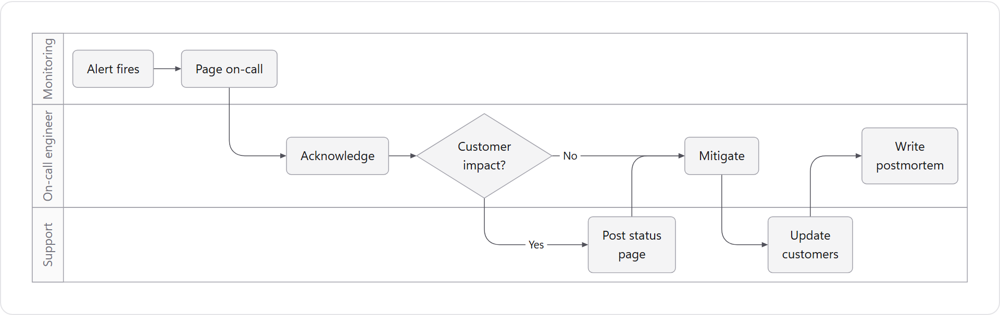
</picture>

**Incident response.** The on-call engineer owns the incident from page to postmortem. Support only talks to customers once impact is confirmed.

<details>
<summary>Mermaid source</summary>

```text
swimlane-beta LR
  subgraph Monitoring
    alert[Alert fires]
    page[Page on-call]
  end
  subgraph oncall[On-call engineer]
    ack[Acknowledge]
    triage{Customer impact?}
    fix[Mitigate]
    review[Write postmortem]
  end
  subgraph Support
    status[Post status page]
    notify[Update customers]
  end
  alert --> page --> ack --> triage
  triage -->|Yes| status --> fix
  triage -->|No| fix
  fix --> notify --> review
```

</details>

### Model a lifecycle

> What states can a subscription be in, and what moves it between them?

<picture>
  <source media="(prefers-color-scheme: dark)" srcset="docs/examples/lifecycle-dark.png">
  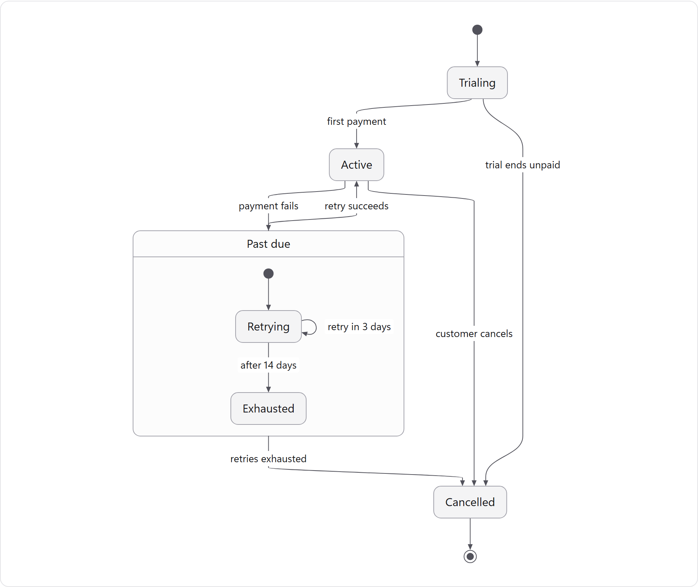
</picture>

**Subscription lifecycle.** Failed payments retry for 14 days inside Past due before the subscription is cancelled. A successful retry returns it to Active.

<details>
<summary>Mermaid source</summary>

```text
stateDiagram-v2
  state "Past due" as PastDue
  [*] --> Trialing
  Trialing --> Active : first payment
  Trialing --> Cancelled : trial ends unpaid
  Active --> PastDue : payment fails
  state PastDue {
    [*] --> Retrying
    Retrying --> Retrying : retry in 3 days
    Retrying --> Exhausted : after 14 days
  }
  PastDue --> Active : retry succeeds
  PastDue --> Cancelled : retries exhausted
  Active --> Cancelled : customer cancels
  Cancelled --> [*]
```

</details>

### Plan a release

> Turn the open issues for 2.0 into a schedule. We have two engineers and want to ship by mid-November.

<picture>
  <source media="(prefers-color-scheme: dark)" srcset="docs/examples/release-plan-dark.png">
  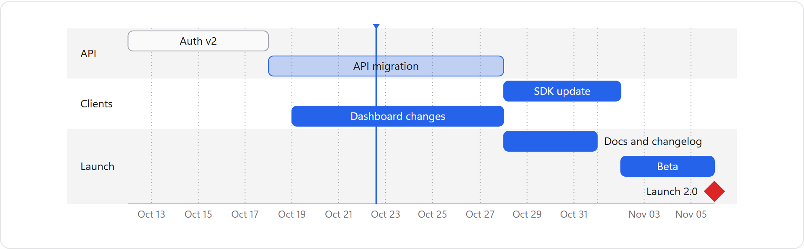
</picture>

**Release 2.0 schedule.** The API migration is the critical path: the SDK and the docs both wait for it, so a slip there moves the launch.

<details>
<summary>Mermaid source</summary>

```text
gantt
  dateFormat YYYY-MM-DD
  axisFormat %b %d
  section API
    Auth v2            :done, auth, 2026-10-12, 6d
    API migration      :active, api, after auth, 10d
  section Clients
    SDK update         :sdk, after api, 5d
    Dashboard changes  :dash, 2026-10-19, 9d
  section Launch
    Docs and changelog :docs, after api, 4d
    Beta               :beta, after sdk, 4d
    Launch 2.0         :crit, milestone, after beta, 0d
```

</details>

### Weigh options

> We need a job queue. Compare the options you found on effort and fit for our stack.

<picture>
  <source media="(prefers-color-scheme: dark)" srcset="docs/examples/compare-options-dark.png">
  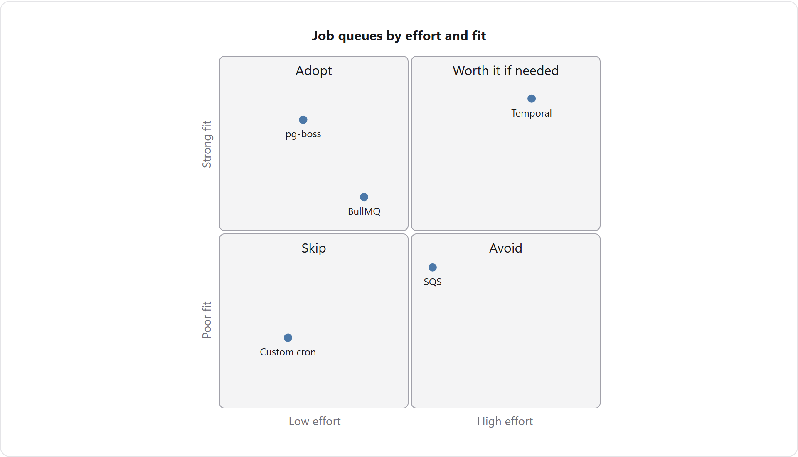
</picture>

**Job queue options.** pg-boss fits best for the least effort because we already run Postgres. Temporal fits better only if workflows become long-running.

<details>
<summary>Mermaid source</summary>

```text
quadrantChart
  title Job queues by effort and fit
  x-axis Low effort --> High effort
  y-axis Poor fit --> Strong fit
  quadrant-1 Worth it if needed
  quadrant-2 Adopt
  quadrant-3 Skip
  quadrant-4 Avoid
  pg-boss: [0.22, 0.82]
  BullMQ: [0.38, 0.6]
  Temporal: [0.82, 0.88]
  SQS: [0.56, 0.4]
  Custom cron: [0.18, 0.2]
```

</details>

### Find the root cause

> The end-to-end suite fails about one run in five. Investigate and map out the causes.

<picture>
  <source media="(prefers-color-scheme: dark)" srcset="docs/examples/root-cause-dark.png">
  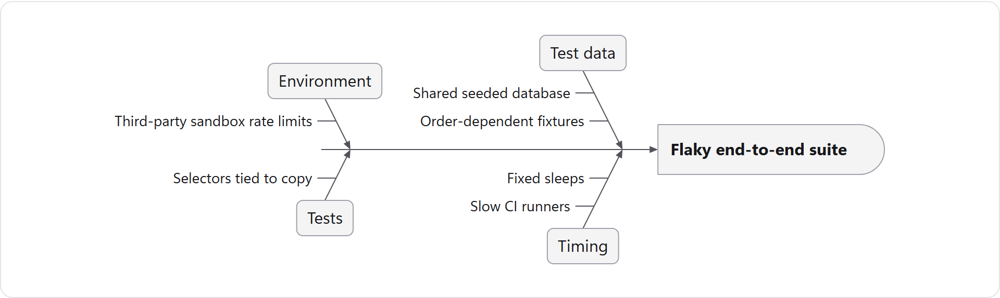
</picture>

**Why the end-to-end suite is flaky.** Two causes explain most failures: tests that share one seeded database, and fixed sleeps that lose to slow CI runners.

<details>
<summary>Mermaid source</summary>

```text
ishikawa-beta
  Flaky end-to-end suite
  Test data
    Shared seeded database
    Order-dependent fixtures
  Timing
    Fixed sleeps
    Slow CI runners
  Environment
    Third-party sandbox rate limits
  Tests
    Selectors tied to copy
```

</details>

### Check how the agent will split up the work

> Migrate the remaining class components to hooks. Use subagents, and show me the plan before you start.

<picture>
  <source media="(prefers-color-scheme: dark)" srcset="docs/examples/agent-plan-dark.png">
  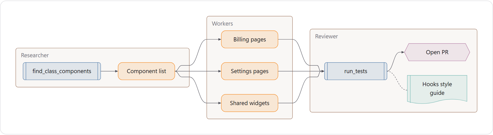
</picture>

**Plan: migrate class components to hooks.** One researcher lists the components, three workers each migrate a share in parallel, and a reviewer runs the tests before opening a PR.

<details>
<summary>Mermaid source</summary>

```text
agentflow-beta LR
  flow research["Researcher"]
    scan["find_class_components"]@{ shape: tool }
    list["Component list"]@{ shape: task }
    scan --> list
  end
  flow workers["Workers"]
    w1["Billing pages"]@{ shape: task }
    w2["Settings pages"]@{ shape: task }
    w3["Shared widgets"]@{ shape: task }
  end
  flow review["Reviewer"]
    tests["run_tests"]@{ shape: tool }
    guide["Hooks style guide"]@{ shape: refdoc }
    pr["Open PR"]@{ shape: action }
    tests --> pr
    tests -.- guide
  end
  list --> w1
  list --> w2
  list --> w3
  w1 --> tests
  w2 --> tests
  w3 --> tests
```

</details>
## What it can draw

| Kind | Diagrams |
| --- | --- |
| Flow and process | flowchart, sequence, state, swimlane, user journey, agentflow |
| Structure | architecture, class, entity relationship, block, C4, tree view, requirement |
| Time and work | Gantt, timeline, kanban, git graph, event modeling |
| Ideas and analysis | mind map, Ishikawa, Cynefin, Wardley map, Venn, quadrant |
| Numbers | pie, XY, sankey, treemap, radar, packet |

See [pele's examples](https://pele.run/examples) for each one.

## How it works

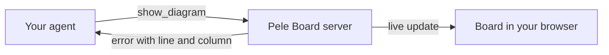

The plugin adds a small local server and a `visualize` skill that teaches the agent when a diagram helps and which
kind to draw. The server checks each diagram with [pele](https://pele.run), Obsidian's Mermaid renderer, and pushes
it to the open board page, which renders it at your screen's width in light or dark mode.

## Settings

Set these in your agent's environment if you need them:

| Variable | Effect |
| --- | --- |
| `PELE_BOARD_NO_OPEN=1` | Never open the browser; the agent gives you the board's address instead. |
| `PELE_BOARD_PORT` | Use this port instead of a random free one. Falls back to a free port if it is taken. |

## Privacy

Everything runs on your computer. The board listens only on `127.0.0.1`, refuses requests addressed to any other
host name, and keeps diagrams in memory for the session. Nothing is uploaded. A diagram that links to an image on
the web loads it when you view the diagram.

Cloud and remote agent sessions run the server on another machine, so the board can't reach your browser there.

## Update and remove

| | Update | Remove |
| --- | --- | --- |
| Claude Code | `claude plugin update pele-board@pele-board`, then restart | `claude plugin uninstall pele-board@pele-board` |
| Codex | `codex plugin marketplace upgrade pele-board`, then start a new session | `codex plugin remove pele-board@pele-board` |

The plugin stores no files outside its installed folder.

## Development

```sh
npm install
npm run typecheck
npm run build           # bundles src/ and web/ into plugin/dist/, which is committed
npm run check:examples  # renders every Mermaid example in the skill with the pinned pele
```

Users install only the `plugin/` folder, which holds the manifests, the skill and the bundled server; the build
tools at the repository root never reach them. `plugin/dist/` is committed because Codex runs plugins without
installing dependencies. Rebuild it after changing `src/` or `web/`, and keep the version in `package.json`,
`plugin/plugin.json`, `plugin/.claude-plugin/plugin.json` and `src/server.ts` in step. Tested hosts and versions
are in [docs/compatibility.md](docs/compatibility.md).

## License

[MIT](LICENSE). Pele Board is not affiliated with pele or Obsidian. Licenses of bundled libraries are in
[plugin/dist/THIRD_PARTY_LICENSES.txt](plugin/dist/THIRD_PARTY_LICENSES.txt).
