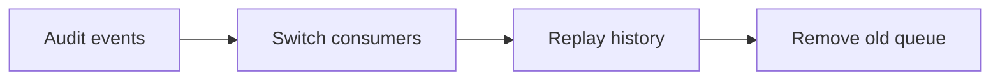

# Visualize work with the Pele Board

`show_diagram` checks Mermaid source with pele and shows it on a live page in the user's browser. It opens the
page when nobody is watching it; an open page updates by itself. The user sees the board, not your Mermaid text.

## When to draw

Draw when the reader would otherwise build the picture in their head: how parts connect, what happens in what
order, where the work stands. Skip it for a single step, a short list, or anything a sentence says as well.

One diagram should answer one question. Prefer two small diagrams over one that shows everything.

## Pick the diagram

| To show | Use |
| --- | --- |
| Steps, decisions, pipelines, dependencies | `flowchart LR` (or `TB` when it is deep) |
| Who calls whom, in what order | `sequenceDiagram` |
| Who does which step across people or systems | `swimlane-beta LR` |
| Lifecycle or modes | `stateDiagram-v2` |
| Components and how they connect | `flowchart` with `subgraph` groups, or `architecture-beta` |
| Tables and relations | `erDiagram` |
| Types and their relations | `classDiagram` |
| Schedule and phases | `gantt` or `timeline` |
| Work items by status | `kanban` |
| Ideas around a topic | `mindmap` |
| A file or folder layout | `treeView-beta` |
| Causes of a problem | `ishikawa-beta` |
| Numbers | `pie`, `xychart`, `quadrantChart`, `sankey`, `treemap-beta`, `radar-beta` |
| Agents, tools and their flow | `agentflow-beta` |
| Branches and merges | `gitGraph` |

The pele-specific types are less well known; see [pele diagram types](references/pele-diagrams.md) before using
any type ending in `-beta`, `eventmodeling` or `block`.

## Show progress on a living diagram

For work with several steps, show the plan once and update it in place as steps finish: call `show_diagram`
again with the same `id`. Update at milestones, not on every tool call.

Mark flowchart and state nodes with these classes; the board colors them for light and dark mode:

In a state diagram, use `class NodeId done`. Do not add `classDef` or `style` for these four classes; fixed
colors ignore the user's theme.

## Write source that reads well

- Labels of one to four words. Put detail in the `caption`, not in the boxes.
- Fifteen nodes or fewer. Group related nodes with `subgraph`.
- Quote labels that contain punctuation: `A["Retry (3x)"]`. Use ` ` for a line break.
- Give the diagram a `title` that names what it shows, and a `caption` only when there is a conclusion to draw.

## After calling the tool

If it returns an error, fix the source at the reported line and call it again; the user never saw the broken
version. On success, tell the user in one line what is on the board, for example "The rollout plan is on the
board." Do not paste the Mermaid source into the chat unless they ask for it.

The board runs on the user's machine at a `127.0.0.1` address. In a remote or cloud session the user's browser
cannot reach it; describe the structure in text instead. Use `remove_diagram` when a diagram no longer reflects
the work.
