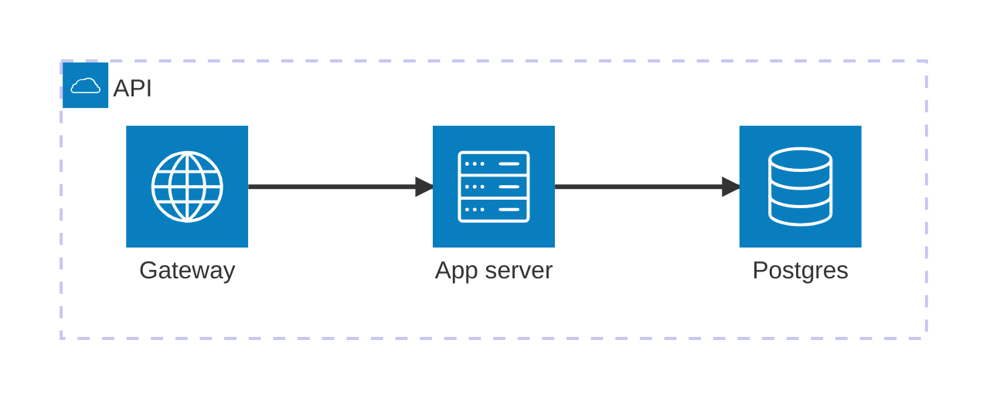
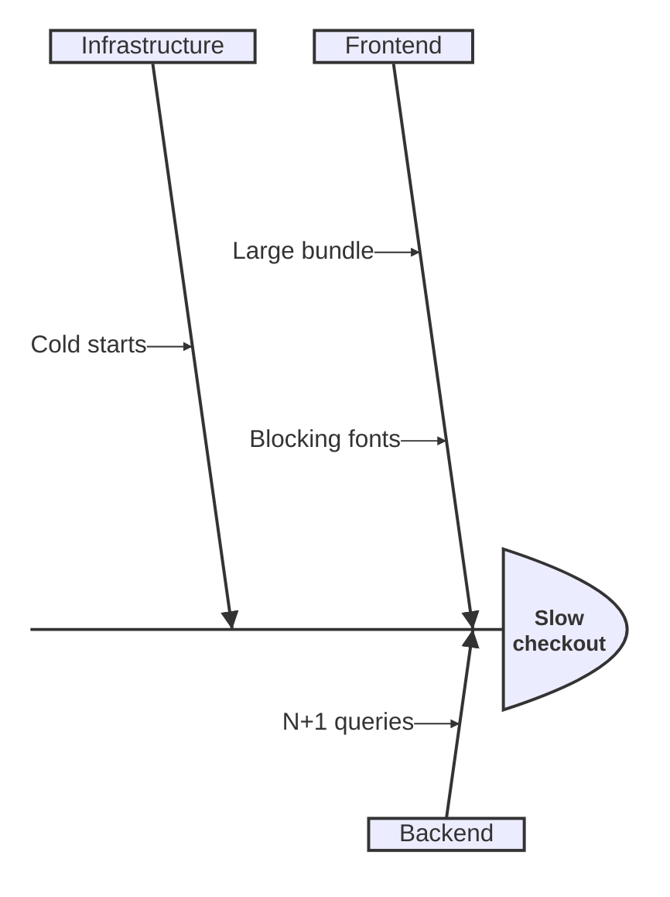
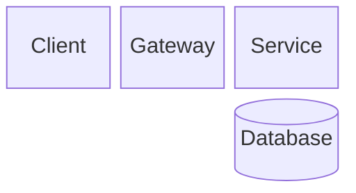
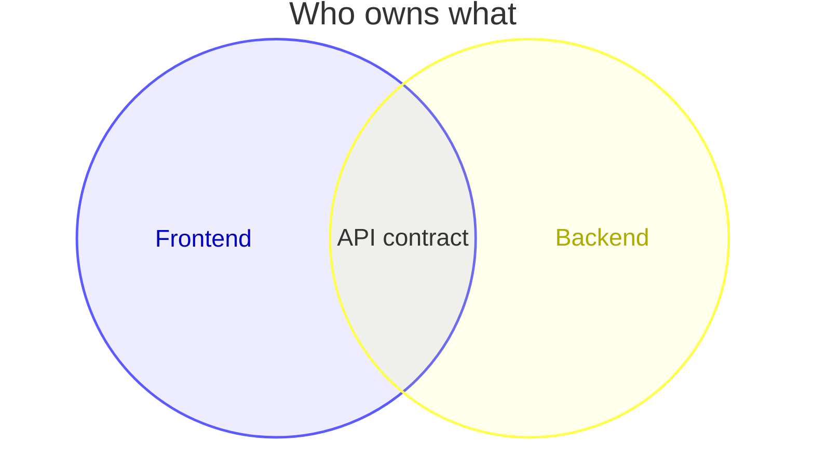
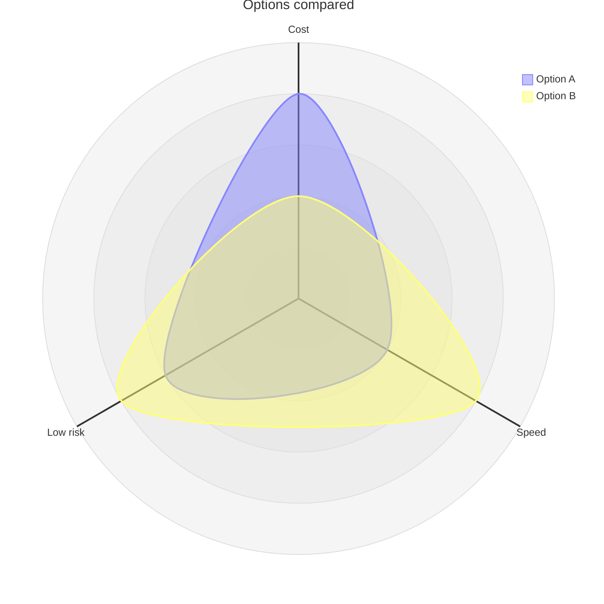
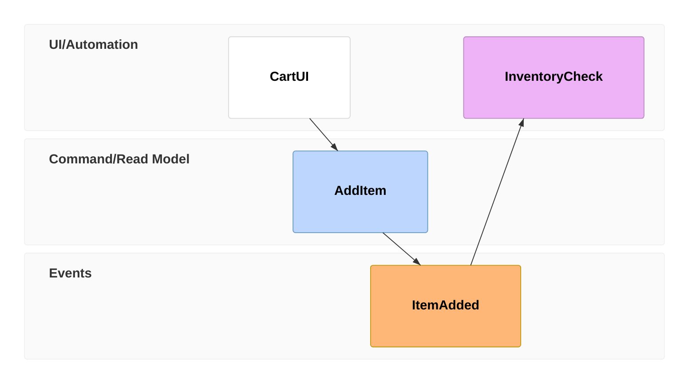

# Pele diagram types

Pele renders standard Mermaid plus several newer types. Each example below renders with the bundled pele version;
adapt the content, keep the structure. More examples: <https://pele.run/examples>.

## Swimlane: who does which step

Each `subgraph` is a lane. Edges cross lanes.

```mermaid
swimlane-beta LR
  subgraph Customer
    request[Request refund]
    receive[Receive money]
  end
  subgraph Support
    triage[Triage request]
    decide{Eligible?}
  end
  subgraph Finance
    pay[Issue refund]
  end
  request --> triage --> decide
  decide -->|Yes| pay --> receive
  decide -->|No| request
```

## Architecture: services and infrastructure

Icons: `cloud`, `database`, `disk`, `internet`, `server`. Edges name the side of each node: `L`, `R`, `T`, `B`.



## Agentflow: agents, tools and data

`flow` blocks group steps. Shapes include `input`, `task`, `tool`, `action` and `refdoc`.

```mermaid
agentflow-beta LR
  flow research["Researcher"]
    question["Question"]@{ shape: input }
    search["web_search"]@{ shape: tool }
    question --> search
  end
  flow writer["Writer"]
    draft["Draft answer"]@{ shape: task }
    guide["Style guide"]@{ shape: refdoc }
    draft -.- guide
  end
  search --> draft
```

## Tree view: files and folders

Indent children; end folders with `/`. `##` adds a comment.


## Ishikawa: causes of a problem

The first line is the problem; each unindented group below is a category of causes.



## Block: a fixed grid of parts



## Cynefin, Wardley, Venn and radar

```mermaid
cynefin-beta
  title Where our open questions sit
  complex
    "Pricing model"
  complicated
    "Data migration"
  clear
    "Release checklist"
  chaotic
    "Production outage"
```

```mermaid
wardley-beta
  title Build or buy
  anchor User [0.95, 0.70]
  component App [0.75, 0.40]
  component Auth [0.50, 0.80]
  component Hosting [0.20, 0.90]
  User -> App
  App -> Auth
  App -> Hosting
```





## Event modeling


